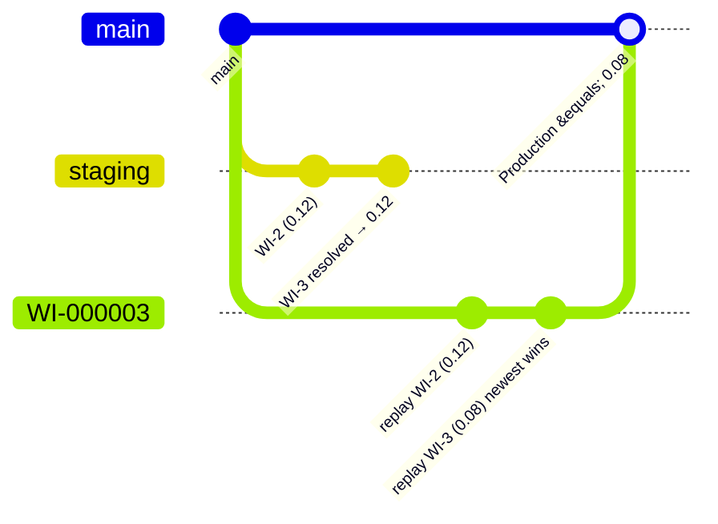

# Combining work items

**Combine** is how Lifecycle Center handles work items that share components (or depend on each other) when
you promote only some of them out of a stage. Its branch rebuild can change the result of a previously resolved conflict, so inspect the prepared
and combined branches before promoting.

## Before promoting the prepared result

- **Prepare builds from the target**, not a copy of the source stage's tested files.
- **Combine can replace a manual resolution.** Inspect the final combined branch after the rebuild.
- **A passing test isn't a content comparison.** Confirm the intended values as well as the test result.
- **A later Promote Stage still matters.** Matching content can leave separate Git histories.

**Practical implication:** compare the final prepared or combined PR with the intended release before promotion.
If some source-stage work is held back, explain those differences rather than requiring an empty full-branch diff.
See [promotion paths and scope](promotions.md) for how this applies at each pipeline boundary.

## Custom promotion starts with "Prepare" (a rebase)

**Observed ([Exp 01](../lab/01-same-lines-conflict.md), request log):** when you custom-promote work items out of a stage, each one is **prepared**
first. The work item's
branch is rebuilt on the **target** branch (`main`) by replaying **only that work item's own commits**, and a
`WI-xxxxxx → main` PR is opened during Prepare.

!!! warning "Custom promotion can leave separate histories, even without overlap (Observed, [Exp 21](../lab/21-c1-custom-promotion-independent.md))"
    The replayed commit is a **new** commit on `main`; `staging` keeps the original. Nothing merges `staging` into
    `main`, so the merge-base stays where the last Promote Stage left it. Content is right and the stage merge stays
    clean, but a later edit to those lines **or the lines next to them** can block Promote Stage. One successful
    Promote Stage repairs it. See [Stuck stage → Prevention](../conflicts/stuck-after-combine.md#prevention).

**Observed ([Exp 05](../lab/05-b3c-combine-dialog-trigger.md)): Prepare resolved the tested conflict without prompting.** When replaying the work item's commit onto `main` conflicts
(here `main` had 0.08, the work item's commit changed 0.09 → 0.10), Prepare reports success and quietly keeps **the work
item's own lines** (0.10). There's no dialog or error, and no conflict markers.

So a custom promotion does **not** merge the stage branch. Production gets main + that work item's changes, which can
be a combination Staging never had.

**Observed ([Exp 04](../lab/04-g1-staging-provenance-check.md)):** two work items changed *different* lines of the same class. Both went to Staging, the newer
one was custom-promoted alone, and its prepared PR held main + the newer change only. That's a version Staging
never had, and **no dialog or warning appeared**. A [staging provenance check](../guardrails/staging-provenance.md)
blocked it.

## When you see the combine dialog

**Observed ([Exp 05](../lab/05-b3c-combine-dialog-trigger.md), 08):** the dialog appeared at promotion after Prepare, when selected work items
shared conflicting lines with other work items in the stage. It appeared with two prepared items
([Exp 05](../lab/05-b3c-combine-dialog-trigger.md)) and with only one prepared item ([Exp 08](../lab/08-c3-stuck-stage-promoted-wi.md)).
It does **not** appear while preparing, not even when the two prepared branches conflict.

??? info "Evidence: dialog triggers and prepared-PR checks"

    | Exp | Prepared | Same lines? | At Promote |
    |---|---|---|---|
    | 01 | both | yes | dialog |
    | 04 | one | no | no dialog (blocked by a failing check) |
    | 04 | both | no | no dialog (blocked by a failing check) |
    | 05 | both | yes (sequential edits) | dialog |
    | 08 | **one** (the other in Staging, not prepared) | yes (sequential edits) | dialog. "Continue" goes straight to the deploy, with no Promotion Options |
    | 14 | both | yes (one hand-resolved in Git) | dialog. Combine → Promotion Options offered |

    **Observed ([Exp 14](../lab/14-e6-fix-broken-combine.md)): any prepared PR that isn't `CLEAN` in GitHub stops the custom promotion at Next**, before the
    dialog, even when the failing check is **not required** (`UNSTABLE`). The UI only shows "Promotion Failed: We couldn't
    complete this task"; the real reason (`CHANGE_REQUEST_VALIDATION`, reason `UNKNOWN`, naming the PR) appears only in
    the page's network response. Check the prepared PRs in GitHub when this happens.

    **Not yet known:** whether a non-conflicting overlap ([Exp 04](../lab/04-g1-staging-provenance-check.md)) would show the dialog when no check is failing. The
    failing check may have been evaluated first. A single prepared work item produced no dialog in [Exp 04](../lab/04-g1-staging-provenance-check.md) (different-line overlap), but did in [Exp 08](../lab/08-c3-stuck-stage-promoted-wi.md)
    (same-line overlap). Do not rely on the dialog to establish whether the result matches Staging.

The **Resolve Shared Components** dialog lists the work items and shared components, and offers:

- **Combine work items into WI-xxxxxx** ("latest versions of the shared components are used")
- **Continue with custom promotion**

It does **not** appear when promoting from Approved into the first stage. Overlapping work items there produce
a conflict block with "Resolve using Agentforce" instead (see
[Where conflicts show up](../conflicts/where-conflicts-show-up.md)).

## What it does in Git

**Observed ([Exp 01](../lab/01-same-lines-conflict.md)):**

1. Uses the **newest** work item as the survivor.
   [Salesforce documents creation order, oldest to newest](https://help.salesforce.com/s/articleView?id=platform.devops_center_combine_work_items.htm&language=en_US&type=5).
   Our observations agree, but did not independently vary creation, commit, and promotion order.
2. **Rebuilds its branch from the target branch** (`main`, not `staging`) by **replaying each work item's
   original commits**, oldest first.
3. Any **other commits on the branch are thrown away**, including a manual conflict-resolution merge we'd pushed.
4. Where lines conflict, **the newest work item's version wins, line by line** ([Exp 01](../lab/01-same-lines-conflict.md); creation order is the documented rule). Changes that don't conflict
   are kept from both.
5. Deletes the older work item's branch. It gets status `COMBINED`.
6. Opens a new PR `WI-000003 → main` and closes the old ones, **except** the open `staging → main` stage PR,
   which is left behind.

## When the combined content matched Staging

**Observed ([Exp 05](../lab/05-b3c-combine-dialog-trigger.md)):** two work items edited the same line **one after the other** (the second developer started from
Staging with the first change already in), so nobody resolved anything by hand. Combine replayed both onto `main`, the
newer value won, and the result was **identical to Staging**. After promotion, `main` and `staging` had the same content
and the stage PR was mergeable; a later edit exposed the history problem ([Exp 06](../lab/06-a3b-git-merge-recovery.md)).

So combine reproduces Staging when the newest work item's own commit already contains the final version of each shared
line. It breaks when the agreed version only exists in a **manual resolution commit** ([Exp 01](../lab/01-same-lines-conflict.md)).

!!! warning "Same content, split history"
    **Observed ([Exp 06](../lab/06-a3b-git-merge-recovery.md)):** even that "safe" combine left a trap. `main` got the combine's rewritten commits while
    `staging` kept the originals, so Git sees both branches changing those lines separately. The next ordinary
    work item that touched a combined line (or the line next to it) blocked Promote Stage. See
    [Stuck stage after a combine](../conflicts/stuck-after-combine.md#prevention) for how to spot and clear it.

## Why it's dangerous

- **Production can get code that was never in Staging.** In [Exp 01](../lab/01-same-lines-conflict.md), Staging had the tested, hand-resolved
  `0.12 / 3000`. The combine sent `0.08 / 2000` to Production. Class and test changed together, so the tests
  passed and nothing flagged it.
- **Hand-resolved conflicts are lost.** If you fixed a conflict by merging `staging` into the work item branch,
  combine discards that commit.
- **Conflicting combine results can block later stage promotions.** In [Exp 01](../lab/01-same-lines-conflict.md)–02, `staging` and `main`
  changed the same lines in different ways, so even an unrelated work item could not pass Promote Stage until
  the branches were reconciled. See
  [Stuck stage after a combine](../conflicts/stuck-after-combine.md).
- **Combining is irreversible**, according to [Salesforce Help](https://help.salesforce.com/s/articleView?id=platform.devops_center_combine_work_items.htm&language=en_US&type=5). This refers to the combine operation; later corrective changes remain possible.
- **Recombining a combined work item failed in the lab. Observed ([Exp 14](../lab/14-e6-fix-broken-combine.md)):** combining it with a new fix-up work item
  fails with `WORKITEM_UPDATE_FAILED` ("Combining work items failed"), on both attempts. The Git half runs anyway and
  rebuilds the branch from the combined work item's **own original commit only**, leaving out the work items it had
  absorbed. So you can't repair a broken combine by combining a fix into it. See
  [Test failures](../conflicts/test-failures.md#when-the-broken-version-only-exists-in-a-combined-work-item).
- **It throws away commits you pushed to a prepared branch. Observed ([Exp 15](../lab/15-e6a-git-fix-for-broken-combine.md)):** a fix committed onto a prepared
  `WI → main` branch was gone after Combine, which replays only the work items' original commits. A fix committed onto
  the **combined** branch afterwards was promoted as-is.
- **Without Combine, a prepared branch is promoted as you left it. Observed ([Exp 20](../lab/20-d1c-commit-on-prepared-branch.md)):** a commit pushed to the
  prepared branch of a work item promoted alone was merged into `main` and deployed.
- **It can build a version that fails its tests. Observed ([Exp 14](../lab/14-e6-fix-broken-combine.md)):** dropping a hand-resolved query line left a
  method reading a field the query no longer selected. The combined promotion does offer the normal test options,
  and with tests chosen it fails cleanly.

!!! tip "Practical implication"
    Promote Stage preserves the source branch history when the entire stage can move forward. Custom promotion
    rebuilds selected work items instead; shared components need particular attention.
    If you must combine, check the combined branch's diff against `staging` before it reaches Production:
    `git diff origin/staging origin/WI-xxxxxx -- force-app`.
