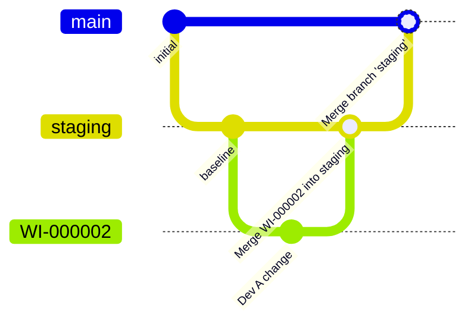

# The Git model

A stage has both a Git branch and a deployed org. They can disagree. This page explains the branch behavior and
deployment scope behind the [promotion paths](promotions.md).

Examples retain the lab's `staging` → `main` names. They describe one stage boundary, not your whole pipeline.

## Branches

| What | Branch | Observed |
|---|---|---|
| Each pipeline stage | One long-lived branch per stage (`staging`, `main`) | [Exp 01](../lab/01-same-lines-conflict.md) |
| Each committed work item | `WI-<number>` (e.g. `WI-000004`) | [Exp 01](../lab/01-same-lines-conflict.md), 02 |
| Base of a work item branch | The **first stage branch** (`staging`), **not** `main` | [Exp 01](../lab/01-same-lines-conflict.md) |

!!! note "Why the base branch matters"
    A work item branch is cut from `staging`, so it already contains everything that's in Staging but not
    yet in Production. Normally that's fine. But if `staging` and `main` have diverged, every work item
    inherits that divergence (see [Stuck stage after a combine](../conflicts/stuck-after-combine.md)).

## Pull requests

The tested promotion paths use GitHub PRs, which Lifecycle Center opens and merges:

| Action in Lifecycle Center | PR title | Head → base |
|---|---|---|
| Promote work item to first stage | `[DevOps Center] Merge WI-000004 to staging` | `WI-000004 → staging` |
| Promote Stage | `Promotion: staging → main` | `staging → main` |
| Custom / combined promotion to a later stage | `[DevOps Center] Merge: WI-000003 → main` | `WI-000003 → main`, opened at **Prepare**, after the branch is rebased onto `main` ([details](combining.md#custom-promotion-starts-with-prepare-a-rebase)) |

**Observed:**

- **A stage PR can exist before you click Promote Stage.** Lifecycle Center opened the `staging → main` PR
  after a work item reached Staging. An open PR does not mean deployment has started; its checks can run before
  promotion. ([Exp 03](../lab/03-e5-branch-protection-gate.md))
- **An existing stage PR collects later work.** New Staging commits update the open PR, including after a failed
  promotion. Inspect its current scope before retrying. ([Exp 02](../lab/02-stage-promotion-after-combine.md))
- **Custom promotion can leave the stage PR open.** Its presence alone does not mean that the custom promotion
  failed. Check its mergeability before the next Promote Stage.
  ([Exp 01](../lab/01-same-lines-conflict.md), [Exp 05](../lab/05-b3c-combine-dialog-trigger.md))

## What a failed promotion leaves behind

In the tested flows, merge conflicts and required branch-protection checks blocked promotion before deployment
([Exp 02](../lab/02-stage-promotion-after-combine.md), [Exp 03](../lab/03-e5-branch-protection-gate.md)).
Failed test deployments left the PR unmerged ([Exp 13](../lab/13-e1-combined-test-failure.md)).

Use the promotion result, deployment report, and PR state to determine what completed. Component modification
timestamps alone do not establish the internal ordering of deployment and merge operations. The timestamp
comparisons remain in the experiment logs.

## What gets deployed

These scope rules describe the tested Apex components and promotion options ([Exp 02](../lab/02-stage-promotion-after-combine.md), 17–19). Validate the
deployment contents for other metadata types before assuming the same behavior.

**Observed:** the default scope follows the promoted work items' components, rather than a full comparison of
branch and org content. It can redeploy an unchanged component while leaving an unrelated branch-only change
undeployed ([Exp 02](../lab/02-stage-promotion-after-combine.md), [Exp 19](../lab/19-d1ab-direct-commit-on-staging.md)).

The "Changes to promote" choice in Promotion Options decides what gets deployed:

| Choice | What's deployed | Deletions | Content taken from |
|---|---|---|---|
| **Only changes missing from \<stage\>** (default) | Components of the promoted **work items** | Yes, from the work items ([Exp 18](../lab/18-e6d-all-changes-and-deletions.md)) | The stage **branch**, so other edits in those files ship too ([Exp 19](../lab/19-d1ab-direct-commit-on-staging.md)) |
| **All changes in the \<stage\> stage branch** | **Every** component in the branch | **Never** ([Exp 18](../lab/18-e6d-all-changes-and-deletions.md)) | The branch |

Consequences, all **Observed**:

- A change in the branch that **no work item carries** (a direct commit, a hand-resolved merge) is merged into the
  next branch but **never deployed** by the default choice. Git and the org then disagree, silently ([Exp 19](../lab/19-d1ab-direct-commit-on-staging.md)).
- If a promoted work item touches the same file, the hand edit **ships with it**, even though no org ever ran it
  ([Exp 19](../lab/19-d1ab-direct-commit-on-staging.md)).
- A deletion of a component the target org never had makes the default choice fail ([Exp 17](../lab/17-e6c-revert-added-component.md)).
- "All changes" redeploys the whole branch, so name tests covering **every** Apex class in it. Coverage is enforced
  on scratch stage orgs too ([Exp 17](../lab/17-e6c-revert-added-component.md), 19).
